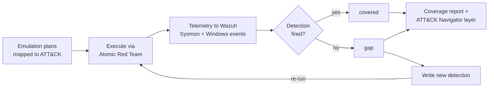

# adversary-emulation

**Systematically run known ATT&CK techniques against my lab with Atomic Red Team, measure which of my detections actually fire, and close the gaps. Coverage is a measured number, not a claim.**

This is the validation layer on top of my detection work. Where [ad-attack-chain](https://github.com/manlikefelo/ad-attack-chain) proved I *can* attack and [detection-engineering](https://github.com/manlikefelo/detection-engineering) proved I *wrote* detections, this repo proves I can **measure and improve detection coverage** against a recognised adversary-emulation framework — the purple-team capability that reads a cut above entry level.

> **Problem:** "I wrote some detections" is unmeasured. Which techniques do they actually catch, and where am I blind?
> **Approach:** run structured ATT&CK emulation plans against the lab, record technique → detected yes/no, and close the gaps.
> **Result:** a measured **4/8 = 50%** coverage figure, a real blind spot found (endpoint process activity + a log source I wasn't collecting), and a new detection written to close the highest-value gap.

---

## The loop



**measure → find gaps → improve → re-measure.** That loop is the whole point.

## Coverage result

**4/8 executed techniques detected = 50%.** Full table: [`reports/coverage-report.md`](reports/coverage-report.md); colour-coded [`reports/navigator-layer.json`](reports/navigator-layer.json) (load at [mitre-attack.github.io/attack-navigator](https://mitre-attack.github.io/attack-navigator/)).

| Technique | ID | Detected | Rule |
|-----------|----|:-------:|------|
| Account Discovery: Domain | T1087.002 | ✅ | 100013 |
| Kerberoasting | T1558.003 | ✅ | 100010 |
| AS-REP Roasting | T1558.004 | ✅ | 100011 |
| DCSync | T1003.006 | ✅ | 100012 |
| System Owner/User Discovery | T1033 | ❌ | *(gap)* |
| System Information Discovery | T1082 | ❌ | *(gap)* |
| System Network Config Discovery | T1016 | ❌ | *(gap)* |
| PowerShell (encoded) | T1059.001 | ❌ → new rule 100016 | *(closing)* |

## What I actually ran

Two emulation plans (see [`emulation-plans/`](emulation-plans/)):
- **Plan A — AD credential access & domain dominance** (Kerberoasting → AS-REP → DCSync, Wizard-Spider-style tradecraft). Detections for these were verified firing end-to-end in [ad-attack-chain](https://github.com/manlikefelo/ad-attack-chain); recorded here with `source: ad-attack-chain` (DC01 stayed powered off this session to respect the 16GB RAM budget).
- **Plan B — local discovery & execution** (T1033/T1082/T1016/T1059.001). **Run live this session** against WS01 — and confirmed as gaps directly. See [`RUN-LOG.md`](RUN-LOG.md).

## The finding that matters

Plan B produced **zero detections** — the blind spot I expected. But digging into *why* surfaced a second layer: **the Sysmon process-creation telemetry wasn't even being collected** from the WS01 agent. You can't detect what you don't collect. Both the missing rule and the missing log source are written up in [`gap-analysis.md`](gap-analysis.md), and I closed the highest-value gap — **encoded PowerShell (T1059.001)** — with a new Sigma rule + Wazuh rule `100016`, validated against the Sigma spec and my own [sigmatest](https://github.com/manlikefelo/sigmatest) evaluator.

That self-critical result — *"I emulated a playbook and found holes in my own detections, including a log source I wasn't collecting"* — is the honest, mature outcome adversary emulation is supposed to produce.

## Layout

```
setup/               Atomic Red Team install + prominent safety rules
emulation-plans/     Plan A (AD) + Plan B (local) mapped to ATT&CK
runbooks/            per technique: exact atomic, expected telemetry, mapped rule
tools/               coverage_report.py -> report + Navigator layer
reports/             coverage-report.md + navigator-layer.json (generated)
detections/          new rule closing the encoded-PowerShell gap (Sigma + Wazuh)
gap-analysis.md      the gaps, the telemetry finding, the fix
results.yml          source of truth: technique -> executed/detected
RUN-LOG.md           the live run, step by step
evidence/            captured run evidence
```

## Safety

Atomic Red Team runs **real** techniques. Everything here targets **my own isolated,
host-only lab** (`10.10.10.0/24`, no internet route), on snapshot-able VMs. Never run
these against a machine you rely on or a network you don't own. See [`setup/`](setup/).

## How it fits the portfolio

Validates [detection-engineering](https://github.com/manlikefelo/detection-engineering) / [detection-as-code](https://github.com/manlikefelo/detection-as-code); re-attacks the [security-homelab](https://github.com/manlikefelo/security-homelab); the new rule feeds back into the detection pipeline. Part of the pinned [cybersecurity-portfolio](https://github.com/manlikefelo/cybersecurity-portfolio) meta-repo. New here? Start with [`docs/reviewer-path.md`](docs/reviewer-path.md).

## License

MIT © 2026 Felix Githure
